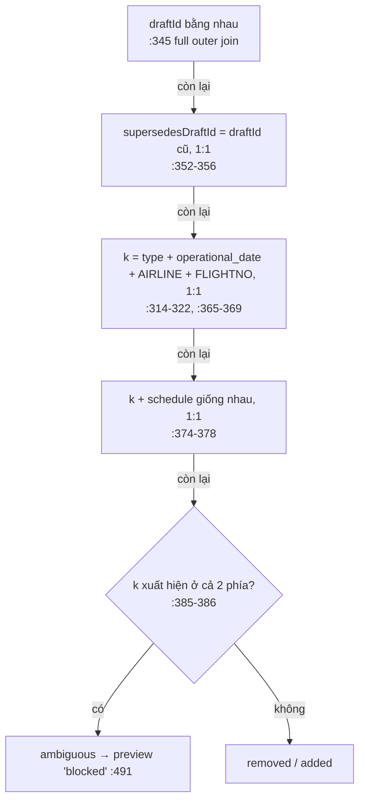

# Rà soát chuyên sâu phân hệ Report — UI/UX & Logic so sánh dữ liệu

- Ngày rà soát: 2026-10-17
- Phạm vi: chỉ đọc, không sửa code. Mọi dẫn chứng có dạng `file:dòng`.
- Ký hiệu nguồn:
  - `app/...` = repo chính `SeasonalManagement` (nhánh `main`, HEAD `f3d32ab`).
  - `[WT] app/...` = worktree `SeasonalManagement-web-traffic-report` (nhánh `codex/web-traffic-report`, HEAD `3551d28` + WIP chưa commit). Theo runbook `docs/runbooks/2026-09-17-traffic-html-compact-header-release.md:12`, Production được deploy **từ worktree này**, không phải từ `main`.
- Mức độ: **Critical** (sai số liệu hiển thị) · **High** · **Medium** · **Low**.
- `[INFERENCE]` = suy luận từ code, chưa quan sát runtime.

---

## 0. Phát hiện kiến trúc cần biết trước

| # | Phát hiện | Bằng chứng | Mức độ |
|---|---|---|---|
| A1 | `main` import các module HTML report **không tồn tại** trên `main`. Edge function `traffic-report` trên `main` không build được nếu deploy từ `main`. | `app/supabase/functions/traffic-report/index.ts:11-14` import `../_shared/trafficHtmlReportRenderer.ts`, `trafficHtmlReportModel.ts`, `trafficHtmlReportContract.ts`, `trafficWorkbookRenderer.ts`; thư mục `app/supabase/functions/_shared/` trên `main` chỉ có `cors.ts`, `dashboardAiShared.ts`. Commit `8b6b649`/`5e6755c`/`28bf969` (traffic-html) chỉ nằm trên `codex/web-traffic-report` (`git branch --contains 8b6b649`). | Critical (quy trình) |
| A2 | Worktree Report có WIP chưa commit: `trafficHtmlVarianceRuntime.ts`, `trafficHtmlVarianceStyles.ts`, migration `20260922120000_public_traffic_html_variance_analysis.sql` là **untracked**; 20 file khác đang sửa (+490/−60). | `git -C SeasonalManagement-web-traffic-report status --short` | High |
| A3 | Hai nhánh lệch nhau từ merge-base `55746c5` (2026-08-31): worktree có 30 commit chưa vào `main`, `main` có 101 commit chưa vào worktree. | `git rev-list --left-right --count main...codex/web-traffic-report` → `101 30` | High |
| A4 | **Production đang chạy đúng HEAD `3551d28` của worktree; Variance CHƯA được deploy.** | Kiểm tra qua SSH (paramiko, chỉ đọc) ngày 2026-10-17: container `opsdata-traffic-report-edge` mount `/srv/seasonal-traffic-report/functions/20260925T140000Z-token-unpin-no-store`. So hash sau khi chuẩn hóa CRLF/LF: 12/13 file `_shared/` (toàn bộ `trafficHtml*`, `trafficWorkbook*`, `trafficReportPresentationAggregates.ts`, `cors.ts`) **khớp HEAD**; chỉ `dashboardAiShared.ts` lệch (ngoài phạm vi report); `traffic-report/index.ts` khớp working copy (WIP handler đã ship). Server **không có** `trafficHtmlVarianceRuntime.ts`/`trafficHtmlVarianceStyles.ts`, không có chuỗi `VARIANCE_ANALYSIS` trong functions; DB: `reporting.traffic_html_periods_v2` và `public.get_public_traffic_html_export_v2` không chứa `VARIANCE_ANALYSIS`. | Thông tin |

Hệ quả: các phát hiện về Weekly/Monthly/Pivot (dẫn chứng `[WT]` các file khớp HEAD) **đang ảnh hưởng người dùng Production**. Các phát hiện về Variance (L3, L7, L8, L9, mục Variance ở bảng 2.1) là **lỗi của tính năng chưa phát hành** — sửa trước khi deploy, không phải hotfix. WIP ở `trafficHtmlReportContract.ts`/`Model.ts`/`Renderer.ts` chỉ thêm nhánh `VARIANCE_ANALYSIS`; không đổi các dòng `sumHtmlMetrics`/`compareHtmlMetrics`/CSS base đã trích dẫn (`git diff -U0`).

---

## 1. Danh mục khảo sát hiện trạng (Current Reports Inventory)

### 1.1 Báo cáo HTML offline (file `.html` tải về, sinh bởi Edge Function) — `[WT]`

| File | Vai trò |
|---|---|
| `[WT] app/supabase/functions/traffic-report/index.ts:880-925` | Route `/v2/html-export`: gọi RPC `get_public_traffic_html_export_v2`, `validateHtmlEnvelope`, trả HTML đính kèm. |
| `[WT] .../_shared/trafficHtmlReportContract.ts` | Kiểu dữ liệu `HtmlEnvelope/HtmlMetric/HtmlRow`; hàm thuần `sumHtmlMetrics` (`:77-90`), `compareHtmlMetrics` (`:91-111`) — được nhúng nguyên văn vào runtime offline. |
| `[WT] .../_shared/trafficHtmlReportModel.ts` | Kiểm tra envelope, hash SHA-256, bất biến metric. |
| `[WT] .../_shared/trafficHtmlReportRenderer.ts` | Lắp shell HTML, CSP, **base CSS + `@media print`** (`:14-16`), chọn runtime theo template. |
| `[WT] .../_shared/trafficHtmlReportRuntime.ts` | Runtime `WEEKLY_DETAIL` (3 tuần: trước/hiện tại/sau) và chế độ "summary" của `PERIOD_ANALYSIS`/`BAO_CAO_SAN_LUONG`. |
| `[WT] .../_shared/trafficHtmlPivotRuntime.ts` + `trafficHtmlPivotStyles.ts` | Runtime pivot đa chiều (mặc định cho `BAO_CAO_SAN_LUONG`, `PERIOD_ANALYSIS`, `MASTER_OPERATIONS`), drill-down, xuất XLSX/ZIP, in chia trang ngang. |
| `[WT] .../_shared/trafficHtmlMonthlyRuntime.ts` + `trafficHtmlMonthlyStyles.ts` | `MONTHLY_OVERVIEW_L2`: 4 kỳ (`previous_year_ago`, `year_ago`, `previous`, `current`), lời bình tự động, phân rã tác động. |
| `[WT] .../_shared/trafficHtmlVarianceRuntime.ts` + `trafficHtmlVarianceStyles.ts` (WIP) | `VARIANCE_ANALYSIS`: Kỳ A vs Kỳ B tự do; 4 tab Radar / Waterfall / Ma trận / Dòng thời gian. |
| `[WT] app/supabase/migrations/20260906120000_public_traffic_html_pivot_v2.sql` | `reporting.traffic_html_periods_v2`, `reporting.traffic_html_period_data_v2`, `public.get_public_traffic_html_export_v2`: chỉ **gom tổng theo kỳ**, không tính delta. |

### 1.2 Web báo cáo công khai (Next.js, `report.ahtops.xyz`) — `app/` (worktree có bản WIP mới hơn)

| File | Vai trò |
|---|---|
| `app/src/app/(public-report)/layout.tsx`, `report.css` | Layout + CSS riêng (717 dòng, **không có `@media print`**). |
| `app/src/app/(public-report)/reports/traffic/TrafficReportClient.tsx` | KPI Tổng/Đến/Đi, badge biến động so kỳ trước/cùng kỳ, xuất Excel. |
| `.../TrafficReportFilters.tsx`, `TrafficReportMultiSelect.tsx` | Thanh lọc sticky, preset ngày, multi-select. |
| `.../TrafficReportDimensionSection.tsx` | Bảng tỷ trọng theo Chặng/Quốc gia/Hãng (phân trang 50, sort phía SQL). |
| `.../TrafficReportTrend.tsx`, `TrafficReportAdvancedCharts.tsx` | Xu hướng ngày, 24 khung giờ, chu kỳ Thứ, cơ cấu đội bay, tính chất chuyến. |
| `.../dashboard/AnnualPassengerKpiDashboard.tsx` | Wallboard KPI khách năm. |
| `app/src/lib/trafficReportDataAdapter.ts`, `trafficReportContract.ts`, `trafficReportV2Contract.ts`, `trafficReportExcelExport.ts` | Adapter/contract/xuất Excel. |
| SQL: `get_public_traffic_report_v2` (`app/supabase/migrations/20260929120000_seasonal_operational_reader_cutover_v1.sql:704-710`), `get_public_traffic_report_dimension_v2` (`20260830213000_public_traffic_report_remove_suppression.sql:387-396`), `get_public_annual_passenger_kpi_v1` (`20260929120000_...:1725-1736`) | Kỳ so sánh, tỷ trọng, tiến độ KPI được **tính sẵn trong SQL**. |

### 1.3 Màn hình báo cáo/so sánh nội bộ (desktop) — `app/`

| File | Vai trò |
|---|---|
| `app/src/app/(desktop)/reports/page.tsx` | Trang `/reports`: tab "Báo cáo sản lượng" (`TrafficReportModePanel`) và tab "So sánh sản lượng" MoM/WoW/YoY (KPI, waterfall, mix, bảng CTG, drill-down). |
| `app/src/lib/dashboardAnalysis.ts` | `buildDashboardComparison` (`:634-712`), `getDashboardOperationalDate` (`:200-209`). |
| `app/src/lib/dashboardReportExport.ts` | Xuất Excel MoM/WoW và "SanLuong". |
| `app/src/app/(desktop)/components/SeasonalVersionChangesView.tsx`, `SeasonalPublishModal.tsx`, `SeasonalVersionHistoryModal.tsx`, `app/src/lib/seasonalDiffFormatters.ts` | **So sánh cấp chuyến bay** (Thêm mới / Xóa / Điều chỉnh) giữa phiên bản lịch mùa. |
| SQL: `public.seasonal_planning_diff_v1` (`app/supabase/migrations/20260928190000_seasonal_planning_v1.sql:313-420`), `get_seasonal_version_changes_v1` (`20261011120000_seasonal_version_changes_v1.sql:181-640`) | Thuật toán matching và phân loại Added/Removed/Modified — **toàn bộ nằm trong SQL**. |

---

## 2. Bảng đánh giá bất cập UI/UX & bố cục

✅ **Checkpoint 1:** Đã rà soát xong bố cục UI/UX và CSS in ấn.

### 2.1 Tổng hợp theo trang

| Tên trang báo cáo | Vấn đề UI/UX phát hiện | Đánh giá khả năng In/PDF | Đề xuất thiết kế lại |
|---|---|---|---|
| **HTML Variance** (`[WT] trafficHtmlVarianceRuntime.ts`) | **High** — Thanh tab dùng class `.pivot-tab-bar`/`.tab-btn` (`:409-413`) nhưng **không có CSS nào** định nghĩa 2 class này (chỉ có `nav.tabs button` trong pivot) → nút mặc định của trình duyệt, không có trạng thái active. **Medium** — Bảng Radar không sắp xếp: chỉ `filter` (`:553-557`); các `.sort(` duy nhất ở `:208,213,883` (Top drivers, Ma trận). **Low** — Header 4 cột chữ (`:488-491`) thừa kế `thead th{text-align:right}` (`trafficHtmlReportRenderer.ts:14`; body mang class `variance-report`, không phải `pivot-report`, `:378`) trong khi ô dữ liệu căn trái. **Low** — CSS data-bar `.cell-delta-wrap/.cell-bar-bg` (`trafficHtmlVarianceStyles.ts:68-71`) không được runtime dùng. | **High** — `.pivot-tab-panel{display:none}` (`trafficHtmlPivotStyles.ts:63`) không bị ghi đè trong `@media print` của variance (`trafficHtmlVarianceStyles.ts:98-106`) → **in/PDF chỉ ra tab đang mở**, 3 tab còn lại mất. **Medium** — chỉ ẩn `.anomaly-filter-bar,.preset-toolbar` (`:102`); thanh ngưỡng `.anomaly-threshold-toolbar` (`:29-33`) và tab bar vẫn in ra. Ưu điểm: thừa kế base print `@page A4 landscape`, `thead{display:table-header-group}`, `tr{break-inside:avoid}` (`trafficHtmlReportRenderer.ts:14`). | Thêm style tab dùng chung với pivot (`nav.tabs`); in nối tiếp 4 tab (`.pivot-tab-panel{display:block!important;break-before:page}`); ẩn mọi control bằng class chung `.controls`; sort Radar mặc định theo `|ΔPax|` giảm dần. |
| **HTML Pivot** (`[WT] trafficHtmlPivotRuntime.ts`) | Ưu điểm: header nhiều tầng sticky được đồng bộ `top` bằng `ResizeObserver` (`:564`); cột đầu `.name` cố định `left:0` (`trafficHtmlReportRenderer.ts:14`); cache tab + khôi phục scroll (`:343-345,1232-1240`). **Medium** — Heatmap giờ **không bao giờ tô màu**: runtime gắn `hot-N` vào `tr` (`:895-896`) còn CSS yêu cầu cùng phần tử `.heatmap-cell.hot-N` (`trafficHtmlPivotStyles.ts:58-62`). **Low** — Toàn bộ CSS `.pivot-kpi-band/.pivot-kpi-card` (`trafficHtmlPivotStyles.ts:73-79`) không có DOM tương ứng → pivot **không có khối KPI tóm tắt** ở đầu trang. | **Medium** — `preparePrint()` thoát sớm khi `bao` (`:371-372`) → `BAO_CAO_SAN_LUONG` bảng rộng (31 ngày) không được chia trang ngang, rơi về `table-layout:fixed;font-size:8px` (`trafficHtmlPivotStyles.ts:23`) — khó đọc. **Medium** — Không có `print-color-adjust:exact` ở bất kỳ stylesheet nào → nền tổng/nhóm/heatmap bị trình duyệt bỏ khi in. | Render khối KPI 4 thẻ (đã có CSS); sửa selector heatmap thành `tr.hot-N .heatmap-cell`; bật chia trang ngang cho `bao` khi số cột vượt ngưỡng; thêm `-webkit-print-color-adjust:exact;print-color-adjust:exact` cho các hàng tổng. |
| **HTML Weekly / Monthly** (`[WT] trafficHtmlReportRuntime.ts`, `trafficHtmlMonthlyRuntime.ts`) | **High** — Sticky header **mất tác dụng**: `.weekly-report .table-scroll{max-height:none}` (`trafficHtmlReportRenderer.ts:16`) và `.monthly-report .table-scroll{max-height:none}` (`trafficHtmlMonthlyStyles.ts:11`) giữ nguyên `overflow:auto` từ base (`trafficHtmlReportRenderer.ts:14`) → `thead th{position:sticky}` bám vào container không cuộn dọc, nên không dính khi cuộn trang. | Base print tốt (lặp `thead`, không cắt dòng, A4 ngang). **Medium** — `.weekly-disclosure:not([open])`/`.monthly-disclosure:not([open]){display:none}` khi in (`trafficHtmlReportRenderer.ts:16`, `trafficHtmlMonthlyStyles.ts:45`) → phần chưa mở trên màn hình bị mất trong PDF. | Khôi phục `max-height` có giới hạn (vd `calc(100vh - <chiều cao header>)`) để bảng cuộn nội bộ và `thead` dính trong container — giống Pivot. **Không** dùng `overflow-x:auto;overflow-y:visible`: khi một trục khác `visible` thì `overflow-y:visible` được tính thành `auto`, container vẫn là scroll ancestor của sticky. Nếu bắt buộc dính theo cuộn trang: tách header thành bảng riêng ngoài vùng cuộn ngang, đồng bộ `scrollLeft` + độ rộng cột. Khi in bung toàn bộ `<details>` (hoặc nút "In đầy đủ" mở hết trước `window.print()`). |
| **Web công khai** (`app/src/app/(public-report)/...`) | **Medium** — Bảng tỷ trọng (50 dòng/trang) không sticky header: `TrafficReportDimensionSection.tsx:228-230` (trong khi bảng xu hướng có `sticky top-0` ở `TrafficReportTrend.tsx:339`). **Low** — Cột không cố định độ rộng → nhảy cột khi đổi trang (`TrafficReportDimensionSection.tsx:228-230`). **Low** — KPI "Tổng" đồng cấp thị giác với "Đến/Đi" (`TrafficReportClient.tsx:470-494`). **Low** — Tab Chặng/Quốc gia dùng `aria-pressed` thay vì `role="tablist"` (`TrafficReportDimensionSection.tsx:175`). | **High** — Không có `@media print` hay tiền tố `print:` trong toàn bộ `(public-report)` (grep rỗng): header tối màu, nút lọc/phân trang/xuất in ra giấy. **Medium** — Bảng chi tiết nằm trong `<details>` đóng (`TrafficReportTrend.tsx:335`, `TrafficReportAdvancedCharts.tsx:201,206,245`) → không in. **Medium** — `min-w-[720px]`/`min-w-[960px]` trong `overflow-x-auto` (`TrafficReportDimensionSection.tsx:228`, `TrafficReportAdvancedCharts.tsx:160`) bị cắt lề khi in. | Thêm print stylesheet trong `report.css`: ẩn filter/nút, bỏ nền tối, `details>*{display:block}`, bỏ `min-width`, lặp `thead`. Thêm `sticky top-[72px]` cho `thead` bảng tỷ trọng (dưới thanh lọc sticky `TrafficReportFilters.tsx:79`). |
| **Desktop `/reports` – So sánh** (`app/src/app/(desktop)/reports/page.tsx`) | **Medium** — Bảng CTG cắt cứng 15 dòng không báo (`:1104`). **Medium** — Drill-down cắt cứng 100 chuyến dù tiêu đề hiện tổng số (`:1288`). **Medium** — Thứ tự CTG cố định theo `|ctgPct|` (`:539-543`), tiêu đề cột không bấm sort được (`:1094-1101`). **Low** — Scroll lồng nhau: `max-h-[380px] overflow-auto` (`:1090`) bên trong `main overflow-y-auto` (`:715`). Ưu điểm: `thead sticky top-0` có nền (`:1092,1247,1276`). | **High** — Gốc trang `h-dvh overflow-hidden` (`:670`) + `main overflow-y-auto` (`:715`) → in chỉ ra phần đang hiển thị; không có `print:` nào. | Thêm `print:h-auto print:overflow-visible` cho gốc/`main`, `print:hidden` cho header/nút/select, `print:max-h-none` cho bảng; thêm "Xem tất cả (N)" và sort theo cột. |
| **Desktop – Diff phiên bản lịch mùa** (`SeasonalVersionChangesView.tsx`, `SeasonalPublishModal.tsx`) | Ưu điểm: mã màu chuẩn — Thêm mới `emerald`, Xóa `rose` + gạch ngang, Điều chỉnh `amber` (`SeasonalVersionChangesView.tsx:434-459,684-689,727`; `SeasonalPublishModal.tsx:539-541`); formatter không bao giờ in `null/undefined` (`seasonalDiffFormatters.ts:165` → "Chưa khai báo"). **Low** — Không ảo hóa danh sách khi "tải thêm" nhiều lần (`SeasonalVersionChangesView.tsx:999`). | Không áp dụng (modal tương tác, không có luồng in). | Giữ nguyên hệ màu, dùng làm chuẩn chung (Mục 4). |
| **Wallboard KPI năm** (`AnnualPassengerKpiDashboard.tsx`) | **Low** — Trạng thái `not_achieved` dùng `amber` giống `at_risk` (`:129`), không phân biệt mức nghiêm trọng. | Không áp dụng (màn hình TV). | `not_achieved` → `rose`. |

### 2.2 Phân cấp thị giác khối KPI

| Báo cáo | Có khối KPI đầu trang? | Nhận xét |
|---|---|---|
| Web công khai | Có, 3 thẻ (`TrafficReportClient.tsx:470-494`), `tabular-nums`, badge Δ% | Tốt; thiếu nhấn mạnh thẻ "Tổng". |
| HTML Weekly/Monthly | Có (khối tổng quan + lời bình) | Tốt. |
| HTML Pivot (mặc định của `BAO_CAO_SAN_LUONG`) | **Không** — CSS có, DOM không | Người đọc phải nhìn dòng tổng trong bảng. |
| HTML Variance | Có, 6 thẻ radar (`trafficHtmlVarianceStyles.ts`), banner đẳng thức waterfall | Tốt; tab bar không có style làm giảm tính chuyên nghiệp. |
| Desktop So sánh | Có, 7 thẻ (`page.tsx:944-952`) | Giá trị `%` trong thẻ **sai 100 lần** (xem L1). |

---

## 3. Báo cáo thẩm định logic so sánh nghiệp vụ

✅ **Checkpoint 2:** Đã kiểm tra xong tính chính xác của công thức tính chênh lệch.

### 3.1 Bản đồ thuật toán

| Bề mặt | 2 tập dữ liệu | Khóa ghép cặp | Tính ở đâu | Công thức Δ / % |
|---|---|---|---|---|
| Diff phiên bản lịch mùa | Snapshot trước vs sau | Cascade 4 tầng (bên dưới) | **SQL** `seasonal_planning_diff_v1` | Không có số; phân loại `added/removed/modified/unchanged/ambiguous` |
| HTML Weekly/Monthly/Pivot | Kỳ hiện tại vs kỳ trước / cùng kỳ năm trước | `JSON.stringify(row.grain[level])` (`[WT] trafficHtmlReportRuntime.ts:118-121`, `trafficHtmlPivotRuntime.ts:610-612`) | SQL gom tổng theo kỳ; **TS** tính Δ | `delta=a−b`, `percent=b≠0?(a−b)/b:null` (`trafficHtmlReportContract.ts:96-97,107-108`); CTG `delta/baseTotal×100` (`trafficHtmlPivotRuntime.ts:851`) |
| HTML Variance | Kỳ A vs Kỳ B tự chọn | Thị trường `${route}|${airline}` (`trafficHtmlVarianceRuntime.ts:90`); Dòng thời gian `(Thứ, lần thứ N)` (`:1098-1120`); Giờ `hour` | **TS** | Như trên + waterfall (`:220-258`) |
| Web công khai | Kỳ hiện tại vs `previous`/`year_ago` | Vô hướng (tổng kỳ) | Kỳ so sánh: **SQL** (`20260929120000_...:704-710`); Δ%: **TS** | `((c−p)/p)×100`, `p=0 → null` (`TrafficReportClient.tsx:53-56`); tỷ trọng: SQL `flights/nullif(total,0)` |
| Desktop So sánh | Kỳ MoM/WoW/YoY | Khóa kỳ từ `getDashboardOperationalDate` (`dashboardAnalysis.ts:215-220`); tác nhân theo chiều (hãng/tuyến/…) | **TS** | `deltaPct=safeRatio(delta,prev)`, `ctgPct=safeRatio(delta,prevTotal)`, `shareShift=curShare−prevShare` — **dạng tỷ lệ 0..1** (`dashboardAnalysis.ts:634-667`) |

### 3.2 Matching cấp chuyến bay (diff phiên bản lịch mùa)

Cascade trong `app/supabase/migrations/20260928190000_seasonal_planning_v1.sql`:



- Phân loại `modified` = JSON trạng thái khác nhau sau khi loại cột kỹ thuật (`:405-408`), nên **mọi** thay đổi nghiệp vụ (giờ, tàu bay, tuyến, quầy, gate, stand, pax…) đều thành `modified`. RPC `get_seasonal_version_changes_v1` tách tiếp thành `diff_time` (gồm `date_shift`), `diff_route`, `diff_aircraft`, nhóm khác (`20261011120000_...:425-475`). → Bóc tách 3 trường hợp **đúng**.
- Rủi ro ghép sai cặp:

| # | Kịch bản | Cơ chế | Hệ quả | Mức độ |
|---|---|---|---|---|
| M1 | Re-import sinh `draftId` mới, không có `supersedesDraftId`, chuyến đổi giờ vượt mốc 05:00 (vd 23:50 → 00:30) | `k` chứa `operational_date` (`:315-322`), đổi ngày khai thác ⇒ đổi `k`; tầng 4 cũng cần cùng `k` | Thành 1 `removed` + 1 `added` thay vì `modified` có `date_shift` | Medium |
| M2 | Cùng số hiệu 2 lần/ngày khai thác (tăng chuyến) và một chuyến đổi giờ | Tầng 3 thất bại (count 2), tầng 4 chỉ ghép được chuyến giữ giờ; chuyến còn lại cùng `k` ở 2 phía ⇒ `ambiguous` | Toàn bộ bản công bố bị `blocked` (`:491`) | Medium |
| M3 | Đổi hãng/số hiệu (thuê chuyến, đổi code) | `airline`, `flightNumber` thuộc `k` | `removed`+`added` — **đúng ngữ nghĩa** nếu nghiệp vụ coi là chuyến khác | Low (xác nhận nghiệp vụ) |

Các báo cáo sản lượng (Weekly/Monthly/Pivot/Variance/Web/Desktop) **không** ghép cặp từng chuyến; chúng so sánh tổng theo nhóm, nên không bị mis-pairing cấp chuyến, nhưng có các lỗ hổng sau.

### 3.3 Lỗ hổng logic & rủi ro sai số liệu

| ID | Mức độ | Bề mặt | Vấn đề | Bằng chứng | Tác động |
|---|---|---|---|---|---|
| **L1** | **Critical** | Desktop So sánh | `formatPct`/`formatPointPct` in `value.toFixed(1)%` **không nhân 100**, trong khi đầu vào là tỷ lệ 0..1. | `app/src/app/(desktop)/reports/page.tsx:91-101`; nguồn tỷ lệ `dashboardAnalysis.ts:634-637,655-667,705`; `coveragePct = available/denominator` (`operationalDashboardAnalysis.ts:297`, test `:202` kỳ vọng `1/3`). Chỗ gọi: `:938, 949, 952, 1036, 1128-1130, 1233`. | +15% hiện **"+0.1%"** (thẻ KPI, cột Chênh lệch %, CTG, dịch chuyển cơ cấu, tỷ lệ phủ khách). Toàn bộ % của tab So sánh sai. |
| **L2** | **Critical** | Desktop So sánh | Pax `null` (chưa nhập/chưa bay) bị coi là `0`. | `dashboardAnalysis.ts:245-252` (`recordValue`, `recordPax`), `page.tsx:172-174`. Đối chiếu: `TrafficReportModePanel.tsx:39,219-220` (null → `—` + đếm "chặng chưa có số liệu") và SQL HTML (`sum(pax) filter(where is_due and pax is not null)`) đã phân biệt đúng. | So sánh khách kỳ hiện tại chưa chốt vs kỳ trước đã chốt ⇒ sụt giảm ảo; Top kéo giảm/CTG/waterfall bị lấp bởi chuyến thiếu số liệu. |
| **L3** | **High** | HTML Variance (và có thể Weekly / Monthly / Pivot) | Nhóm **chỉ có ở 1 kỳ** (mới mở / ngừng khai thác) có Δ = `null`. `sumHtmlMetrics([])` trả `flights=null` khi `emptyCoverage='missing'` (mặc định) (`trafficHtmlReportContract.ts:77-81`) ⇒ `compareHtmlMetrics` trả `{delta:null}` (`:93`). | Variance: `it.metricA = sum(it.rowsA)` (`trafficHtmlVarianceRuntime.ts:121-130`); Top drivers lọc `deltaPax !== null` (`:207,212`). | Dòng "[Mới]"/"[Dừng]" trên Radar hiện "—" ở ΔCB/ΔPax/%Đóng góp; **Top 5 tăng/giảm bỏ sót tuyến mới/ngừng** dù có thể là tác nhân lớn nhất. (Waterfall vẫn đúng vì tính riêng `sNew/sDropped`, `:220-232`.) Weekly/Monthly/Pivot dùng cùng `compareHtmlMetrics` nên nhóm vắng mặt một kỳ cũng hiện "—" `[INFERENCE: chưa chạy fixture]` — thận trọng khi kỳ chưa đủ dữ liệu, nhưng mất thông tin khi kỳ đã `complete`. |
| **L4** | **High** | HTML Monthly | "TB/ngày" trong bảng chia cho **số ngày đã qua** khi tháng chưa kết thúc (`trafficHtmlMonthlyRuntime.ts:110-111`), còn lời bình ngay bên dưới chia cho **toàn bộ số ngày lịch** (`:138`). | Như dẫn chứng | Hai con số bình quân khác nhau cho cùng chỉ tiêu trong cùng báo cáo tháng đang chạy. |
| **L5** | **High** | Desktop xuất Excel SanLuong | Excel gán `'Ops Date' = record.date` (`dashboardReportExport.ts:114`) và gom tháng theo đó (`:271`), trong khi UI dùng `getDashboardOperationalDate` (ưu tiên `operationalDate`, lùi 1 ngày nếu trước 05:00) (`dashboardAnalysis.ts:200-209`). `FlightRecord` có cả `date` và `operationalDate` riêng (`app/src/lib/types.ts:120-123`). | Như dẫn chứng | Chuyến 00:00–04:59 ngày đầu tháng lệch tháng giữa web và Excel `[INFERENCE: mức lệch phụ thuộc số bản ghi có date ≠ operationalDate]`. |
| **L6** | **Medium** | Desktop So sánh YoY/MoM | So sánh tổng tuyệt đối, không chuẩn hóa theo số ngày khi kỳ là một phần (đầu/cuối mùa). | `dashboardAnalysis.ts:678-679` lọc theo `periodKey` | Tháng có 3 ngày khai thác so với tháng đủ 31 ngày ⇒ −90% giả. Không có cảnh báo "kỳ không đầy đủ". (HTML Monthly đã xử lý bằng `contains_future` + số ngày đã qua.) |
| **L7** | **Medium** | HTML Variance – Dòng thời gian | Ghép `(Thứ, lần thứ N)` không nhận biết ngày lễ/Tết lệch giữa 2 năm. | `trafficHtmlVarianceRuntime.ts:1098-1120` | Tết năm A ghép với ngày thường năm B ⇒ spike/dive giả. |
| **L8** | **Medium** | HTML Variance – Waterfall | `deltaLoadPax` là **số bù** (`:243`) gánh cả hiệu ứng tải lẫn sai số làm tròn của 2 hạng `Math.round` (`:240,242`); hiệu ứng "Số ngày" dùng ngày lịch (`calendar_days`, `:11-12`) chứ không phải ngày có khai thác. | Như dẫn chứng | Đẳng thức luôn khép kín nhưng nhãn "Hệ số tải" có thể chứa phần dư không phải tải. Cần ghi chú trong UI. |
| **L9** | **Low** | HTML Variance | Matching key bỏ `country` so với plan (`(country, route, airline)`); `country` lấy từ dòng đầu tiên (`:93`). | `trafficHtmlVarianceRuntime.ts:89-93` | Chỉ sai nếu cùng mã tuyến thuộc 2 quốc gia (hiếm). |

### 3.4 Edge cases (chia 0, null, NaN)

| Bề mặt | Chia cho 0 | null / undefined / NaN khi hiển thị | Đánh giá |
|---|---|---|---|
| HTML contract | `b !== 0 ? … : null` (`trafficHtmlReportContract.ts:97,108`); pax cần `reported_legs>0` ở cả 2 kỳ (`:101-103`) | `—` | Đúng. |
| HTML Variance | `totalPaxB>0` trước khi tính đóng góp (`:132-133`); `flContB>0` (`:241`); `daysB = max(1,…)` (`:12`) | `fmtNum/fmtPct/fmtSigned` dùng `isNaN` (`:47-59`) — `isNaN(Infinity)===false` ⇒ có thể in `+Infinity%` nếu phát sinh vô hạn. | **Low** — hiện chưa thấy đường sinh `Infinity`; nên đổi `Number.isFinite`. |
| HTML Pivot / Monthly | CTG guard `baseTotal===0 → null` (`trafficHtmlPivotRuntime.ts:851`) | `fmt = n === null ? '—' : …` (`trafficHtmlPivotRuntime.ts:29`, `trafficHtmlMonthlyRuntime.ts:14`) — `undefined` sẽ ra chuỗi `"NaN"`. `trafficHtmlReportRuntime.ts:19` dùng `== null` (đúng). | **Low** — không đồng nhất giữa 3 runtime. |
| Web công khai | `previous === 0 → null` (`TrafficReportClient.tsx:54`) | Formatter dùng `== null` (`TrafficReportClient.tsx:45`, `TrafficReportDimensionSection.tsx:27-31`, `AnnualPassengerKpiDashboard.tsx:60-70`) — không chặn `NaN`. | **Low** — dữ liệu số đến từ SQL; `NaN` chỉ có thể sinh từ phép tính client `[INFERENCE]`. Badge `value >= 0` tô xanh cả 0% (`TrafficReportClient.tsx:60`); kỳ trước = 0 không hiện badge "Mới". |
| Desktop So sánh | `safeRatio` trả `null` (`dashboardAnalysis.ts:634-637`) | `formatValue/formatPct` chặn `null/NaN` → `-` (`page.tsx:80-101`) | Guard đúng, **nhưng thang % sai (L1)**. Excel ghi `'Delta %': deltaPct ?? ''` (`dashboardReportExport.ts:194`) — giá trị tỷ lệ thô, ô trống khi kỳ trước = 0. |
| Diff lịch mùa | Không áp dụng | `formatSingleValue` → "Chưa khai báo"/"—" (`seasonalDiffFormatters.ts:165`) | Đúng. |

### 3.5 Bố trí cột so sánh & sắp xếp

| Bề mặt | Thứ tự cột | Sắp xếp | Mã màu |
|---|---|---|---|
| HTML Variance | Kỳ B → Kỳ A → Δ → % → % đóng góp (**đúng chuẩn**) | Radar: **không sort**; Ma trận: `|ΔPax|` giảm dần (`:883`); Top drivers theo ΔPax | `.diff-pos #15803d`, `.diff-neg #b91c1c`, `.diff-zero #64748b`; badge Mới/Dừng/Tăng vọt/Giảm sâu/Lệch |
| HTML Weekly/Monthly/Pivot | Kỳ → so sánh → Δ (+ `small` %) | Hỗ trợ sort "impact" theo `|Δ|` (`trafficHtmlReportRuntime.ts:384`) | Như trên (WCAG AA đạt: 4.88 / 5.67 / 4.54) |
| Web công khai | Không có bảng so sánh dòng; chỉ badge Δ% trên KPI | Bảng tỷ trọng sort phía SQL (`flights/pax/label`) | emerald/rose |
| Desktop So sánh | Tác nhân → Hiện tại → Kỳ trước → Δ → Δ% → CTG → Δ cơ cấu (**Hiện tại đứng trước Kỳ trước — ngược chuẩn**) (`page.tsx:1094-1101`) | Cố định `|ctgPct|` | emerald/rose |
| Diff lịch mùa | Loại → Ngày → Chuyến → Trước → Sau | SQL `operational_date, side, flight_number` (`20261011120000_...:394,586`) | emerald/rose/amber (chuẩn) |

Không bề mặt nào có màu riêng cho "điều chỉnh giờ" trong báo cáo sản lượng; chỉ diff lịch mùa có `amber` cho `modified` (đúng chuẩn đề bài).

---

## 4. Mẫu layout đề xuất cho bảng so sánh chuẩn

### 4.1 Wireframe

```text
┌──────────────────────────────────────────────────────────────────────────────────────────────┐
│ BÁO CÁO SO SÁNH SẢN LƯỢNG · Kỳ A 01/09–30/09/2026  vs  Kỳ B 01/09–30/09/2025   [In] [Excel] │ ← header gọn, ẩn nút khi in
├───────────────┬───────────────┬───────────────┬───────────────┬──────────────────────────────┤
│ Chuyến bay    │ Hành khách    │ Tuyến mới     │ Tuyến ngừng   │ Độ phủ khách: 99,8% (tạm)    │ ← KPI band 4–5 thẻ
│ 4.210 → 4.512 │ 612k → 655k   │ +3 (+8.420)   │ −1 (−1.050)   │                              │
│ +302 · +7,2%  │ +43k · +7,0%  │               │               │                              │
├───────────────┴───────────────┴───────────────┴───────────────┴──────────────────────────────┤
│ Sắp xếp: (•) |Δ| lớn nhất  ( ) Δ% ( ) Thời gian  · Lọc: [Tất cả|Mới|Ngừng|Tăng|Giảm|Đổi giờ] │
╞═══════╤═══════════════════╦═══════════════════════════════╦═══════════════════════════════════╡ ← sticky top:0 (2 tầng)
│ Trạng │ Tuyến · Hãng      ║        CHUYẾN BAY             ║            HÀNH KHÁCH             │
│ thái  │ (cố định trái)    ║  Kỳ B │  Kỳ A │   Δ  │  Δ%    ║  Kỳ B │  Kỳ A │   Δ   │ Δ% │ %ĐG  │
╞═══════╪═══════════════════╬═══════╪═══════╪══════╪════════╬═══════╪═══════╪═══════╪════╪══════╡
│ [MỚI] │ ICN · 7C          ║     — │    60 │  +60 │  Mới   ║     — │ 8.420 │ +8.420│ Mới│ +1,4 │ ← xanh lá
│[NGỪNG]│ KIX · VJ          ║    30 │     — │  −30 │ −100%  ║ 1.050 │     — │ −1.050│−100│ −0,2 │ ← đỏ
│ [▲]   │ SGN · VN          ║   300 │   360 │  +60 │ +20,0% ║ 45.0k │ 54.1k │ +9.1k │+20 │ +1,5 │
│ [⏱]   │ HAN · QH          ║   120 │   120 │    0 │  0,0%  ║ 18.0k │ 17.2k │  −800 │ −4 │ −0,1 │ ← cam: đổi giờ/slot
├───────┴───────────────────╫───────┼───────┼──────┼────────╫───────┼───────┼───────┼────┼──────┤
│ TỔNG                      ║ 4.210 │ 4.512 │ +302 │ +7,2%  ║  612k │  655k │  +43k │ +7 │ +7,0 │ ← tfoot, lặp khi in
└───────────────────────────╨───────┴───────┴──────┴────────╨───────┴───────┴───────┴────┴──────┘
```

Quy tắc:
1. Thứ tự cố định **Cũ (Kỳ B) → Mới (Kỳ A) → Δ tuyệt đối → Δ%** cho mỗi nhóm chỉ tiêu; `%ĐG` (đóng góp vào biến động chung, điểm %) đặt cuối.
2. Kỳ B = 0 hoặc vắng mặt ⇒ Δ% hiện chữ **"Mới"**; Kỳ A vắng mặt ⇒ **−100%** và nhãn "Ngừng" (chỉ khi resource kỳ đó `complete`). Không bao giờ hiện `Infinity/NaN`.
3. Sticky: `thead` 2 tầng `position:sticky; top:0` trong container **có `max-height`** (hoặc không `overflow` dọc để dính theo viewport); cột 1–2 `left:0`; ô góc `z-index` cao nhất.
4. Sort mặc định `|Δ| giảm dần`; cho phép đổi sang Δ% và thời gian khai thác; số liệu `font-variant-numeric: tabular-nums`, căn phải; header căn theo cột dữ liệu.

### 4.2 Hệ màu khuyến nghị (đồng bộ với token đang dùng)

| Ngữ nghĩa | Chữ | Nền badge | Đang có ở |
|---|---|---|---|
| Tăng / Mới | `#15803d` (green-700) | `#dcfce7` | `.diff-pos`, `.badge-new`, `emerald` |
| Giảm / Ngừng / Hủy | `#b91c1c` (red-700) | `#fee2e2` | `.diff-neg`, `.badge-dropped`, `rose` |
| Điều chỉnh giờ / slot / tàu | `#b45309` (amber-700) | `#fef3c7` | `.badge-divergent`, `amber` (diff lịch mùa) |
| Không đổi (Δ = 0) | `#64748b` (slate-500) | — | `.diff-zero` (web công khai chưa dùng) |
| Dữ liệu tạm / thiếu | `#854d0e` | `#fef9c3` + viền nét đứt | `.badge-warning` |

In ấn: thêm `-webkit-print-color-adjust:exact; print-color-adjust:exact` cho badge và hàng tổng; giữ ký hiệu `+/−`, `▲/▼` để bản in đen trắng vẫn đọc được.

---

## 5. Kế hoạch cải tiến ưu tiên

**Điều kiện tiên quyết (P0):** gộp `codex/web-traffic-report` vào `main` theo Mục 6 để có một code-of-record duy nhất, rồi mới thực hiện Nhóm 1–3 trên `main`.

### Nhóm 1 — Sửa lỗi logic tính toán sai & null/NaN (ưu tiên cao nhất)

| # | Việc | Vị trí sửa | Kiểm chứng |
|---|---|---|---|
| 1.1 | Nhân 100 trong `formatPct`/`formatPointPct` (hoặc đổi tên thành `formatRatioPct`) cho mọi chỗ gọi nhận tỷ lệ; kiểm tra lại `coveragePct`. | `app/src/app/(desktop)/reports/page.tsx:91-101` | Unit test: `deltaPct=0.15 → "+15.0%"`, `ctgPct=0.05 → "+5.00 pts"`; mở `/reports` tab So sánh, đối chiếu tay 1 tác nhân. |
| 1.2 | Phân biệt pax `null` và `0` khi `metric='pax'`: loại chuyến chưa báo cáo khỏi cả 2 kỳ hoặc hiển thị độ phủ + cảnh báo "tạm"; tái dùng mô hình `reportedPax/missingDueLegs` của `TrafficReportModePanel.tsx:219-220`. | `app/src/lib/dashboardAnalysis.ts:245-252`, `page.tsx:172-174` | Fixture: kỳ trước 10 chuyến × 100 pax, kỳ này 10 chuyến trong đó 5 `pax=null` ⇒ không được ra −50%. |
| 1.3 | Nhóm chỉ có ở 1 kỳ: khi resource kỳ vắng mặt `complete=true` và `flight_coverage='complete'`, gọi `sum(rows, 'complete')` để `flights=0` (pax = 0 chỉ khi kỳ đó pax complete) ⇒ Δ có giá trị, Δ% = "Mới"/−100%. Bỏ lọc loại tuyến mới/ngừng khỏi Top drivers. | `[WT] trafficHtmlVarianceRuntime.ts:121-133,207-213`; `[WT] trafficHtmlReportContract.ts:77-81` (tham số `emptyCoverage` đã có sẵn) | Mở rộng `[WT] app/scripts/test-traffic-html-variance-regression.mjs` với 1 tuyến mới + 1 tuyến ngừng: Radar hiện Δ, Top 5 có tuyến mới. |
| 1.4 | Thống nhất mẫu số "TB/ngày" giữa bảng và lời bình tháng (cùng dùng số ngày đã qua khi `contains_future`). | `[WT] trafficHtmlMonthlyRuntime.ts:110-111,138` | Fixture tháng đang chạy: 2 giá trị bằng nhau. |
| 1.5 | Excel SanLuong dùng `getDashboardOperationalDate(record)` cho `Ops Date`/`Weeknum`. | `app/src/lib/dashboardReportExport.ts:114-116` | Bản ghi `date=2026-05-01 schedule=02:30` ⇒ Excel ghi tháng 4, khớp UI. |
| 1.6 | Chuẩn hóa formatter: `Number.isFinite(n) ? … : '—'` cho `fmt` (Pivot/Monthly), `fmtNum/fmtPct/fmtSigned` (Variance), `formatShare/display*` (Web). | `[WT] trafficHtmlPivotRuntime.ts:29`, `[WT] trafficHtmlMonthlyRuntime.ts:14`, `[WT] trafficHtmlVarianceRuntime.ts:47-59`, `TrafficReportDimensionSection.tsx:30-31`, `AnnualPassengerKpiDashboard.tsx:60-70` | Unit test `undefined/NaN/Infinity → "—"`. |
| 1.7 | Cảnh báo kỳ không đầy đủ (MoM/YoY) và tùy chọn so sánh bình quân/ngày. | `app/src/lib/dashboardAnalysis.ts:687-712` | Kỳ 3 ngày vs 31 ngày ⇒ hiện banner + Δ bình quân/ngày. |
| 1.8 | (Cần xác nhận nghiệp vụ) Diff lịch mùa: thêm tầng ghép `type+airline+flightNo` với `|Δ op_date| ≤ 1` khi giờ mới thuộc khung 00:00–05:00; thêm tie-break `linkId/turnaroundId` cho chuyến trùng số hiệu trước khi kết luận `ambiguous`. | `app/supabase/migrations/20260928190000_seasonal_planning_v1.sql:365-386` (bằng migration mới) | Kiểm thử PGlite: 23:50→00:30 ⇒ `modified` + `date_shift`; 2 chuyến cùng số hiệu, 1 đổi giờ ⇒ không `blocked`. |

### Nhóm 2 — Bố cục bảng, sticky header, màu Diff

| # | Việc | Vị trí |
|---|---|---|
| 2.1 | Style tab Variance: dùng lại `nav.tabs` của pivot hoặc thêm CSS `.pivot-tab-bar/.tab-btn` (active border, focus). | `[WT] trafficHtmlVarianceRuntime.ts:409-413`, `trafficHtmlVarianceStyles.ts` |
| 2.2 | Sửa sticky Weekly/Monthly: khôi phục `max-height` có giới hạn cho `.table-scroll` (cuộn nội bộ, `thead` dính trong container như Pivot). Không dùng `overflow-y:visible` kèm `overflow-x:auto` (bị tính thành `auto`, không có tác dụng). Muốn dính theo cuộn trang thì phải tách header ra ngoài vùng cuộn ngang và đồng bộ `scrollLeft`. | `[WT] trafficHtmlReportRenderer.ts:16`, `trafficHtmlMonthlyStyles.ts:11` |
| 2.3 | Sticky `thead` cho bảng tỷ trọng web (offset dưới thanh lọc 72px), cố định độ rộng cột số. | `TrafficReportDimensionSection.tsx:228-230` |
| 2.4 | Sort Radar theo `|ΔPax|` (fallback `|ΔCB|`); cho phép bấm tiêu đề cột để đổi sort ở bảng CTG desktop. | `[WT] trafficHtmlVarianceRuntime.ts:553-557`; `page.tsx:539-543,1094-1101` |
| 2.5 | Đảo cột desktop thành Kỳ trước → Hiện tại → Δ → Δ%. | `page.tsx:1094-1101,1104-1130` |
| 2.6 | Bỏ cắt cứng 15/100 dòng hoặc thêm "Xem tất cả (N)". | `page.tsx:1104,1288` |
| 2.7 | Sửa selector heatmap `tr.hot-N .heatmap-cell` (và chữ tối ở mức cao nhất để đạt AA). | `[WT] trafficHtmlPivotStyles.ts:58-62` |
| 2.8 | Render khối KPI cho Pivot (CSS sẵn có) hoặc xóa CSS chết. | `[WT] trafficHtmlPivotStyles.ts:73-79`, `trafficHtmlPivotRuntime.ts` |
| 2.9 | Màu trung tính cho Δ = 0 (web), `not_achieved` → `rose`, căn trái header cột chữ Variance. | `TrafficReportClient.tsx:60`; `AnnualPassengerKpiDashboard.tsx:129`; `[WT] trafficHtmlVarianceRuntime.ts:488-491` |
| 2.10 | Hiển thị data-bar trong ô Δ (CSS sẵn có) hoặc xóa CSS chết. | `[WT] trafficHtmlVarianceStyles.ts:68-71` |

### Nhóm 3 — Tối ưu CSS in ấn / xuất PDF

| # | Việc | Vị trí |
|---|---|---|
| 3.1 | Variance in đủ 4 tab: `@media print{.pivot-tab-panel{display:block!important}.pivot-tab-panel+.pivot-tab-panel{break-before:page}.pivot-tab-bar,.anomaly-threshold-toolbar{display:none!important}}`. | `[WT] trafficHtmlVarianceStyles.ts:98-106` |
| 3.2 | Thêm `print-color-adjust:exact` cho hàng tổng, badge, heatmap. | `[WT] trafficHtmlReportRenderer.ts:14`, `trafficHtmlPivotStyles.ts`, `trafficHtmlMonthlyStyles.ts` |
| 3.3 | Bật chia trang ngang cho `BAO_CAO_SAN_LUONG` khi số cột vượt ngưỡng. | `[WT] trafficHtmlPivotRuntime.ts:371-372` |
| 3.4 | Bung `<details>` khi in (hoặc nút "In đầy đủ" mở hết trước `window.print()`). | `[WT] trafficHtmlReportRenderer.ts:16`, `trafficHtmlMonthlyStyles.ts:45`; web: `TrafficReportTrend.tsx:335`, `TrafficReportAdvancedCharts.tsx:201,206,245` |
| 3.5 | Print stylesheet cho web công khai: ẩn `TrafficReportFilters`, nút, phân trang; bỏ nền tối header; bỏ `min-w-*`; `thead{display:table-header-group}`, `tr{break-inside:avoid}`, `@page{size:A4 landscape}`. | `app/src/app/(public-report)/report.css` |
| 3.6 | Desktop `/reports`: `print:h-auto print:overflow-visible` cho gốc và `main`, `print:hidden` cho header/nút/select, `print:max-h-none print:overflow-visible` cho container bảng. | `app/src/app/(desktop)/reports/page.tsx:670,715,1090,1245,1274` |

Kiểm chứng chung cho Nhóm 2–3: Playwright mở HTML đã xuất ở 1440×900 (cuộn 2000px, đo `thead` vẫn `top=0`) và `page.pdf({format:'A4', landscape:true})` — kiểm tra số trang, `thead` lặp mỗi trang, đủ 4 tab Variance. Repo đã có tiền lệ: `[WT] app/scripts/test-traffic-html-variance-regression.mjs`, `[WT] app/scripts/verify-ux-1440.mjs`.

---

## 6. Đánh giá gộp worktree Report vào `main`

Kết quả chạy thử `git merge-tree --write-tree --name-only main codex/web-traffic-report` (chỉ đọc, không đụng working tree), ngày 2026-10-17:

| Hạng mục | Kết quả |
|---|---|
| Tự gộp được | `_shared/` 12 file chỉ có ở nhánh report (renderer/runtime/styles HTML, workbook, aggregates) — `main` chưa có file nào nên thêm vào không xung đột; `package-lock.json`, `public_traffic_report_v1_pglite.mjs`, `docs/runbooks/public-traffic-report-deploy.md`. |
| **Xung đột: 16 file, 80 hunk** | `TrafficReportClient.tsx` (11), `trafficReportDataAdapter.ts` (11, add/add), `TrafficReportDimensionSection.tsx` (6), `TrafficReportTrend.tsx` (6), `trafficReportDataAdapter.test.ts` (6, add/add), `trafficReportV2Contract.ts` (6, add/add), `trafficReportV2Contract.test.ts` (6, add/add), `traffic-report/index.ts` (5), `TrafficReportAdvancedCharts.tsx` (5), `traffic-report-edge-contract.test.mjs` (5), `trafficReportContract.ts` (4), `build-traffic-report-only.mjs` (3), `AnnualPassengerKpiDashboard.tsx` (3), `package.json` (1), `TrafficReportPresentation.source.test.ts` (1), `trafficReportContract.test.ts` (1). |
| Nguyên nhân xung đột | `main` đã từng đồng bộ tay một phần code report (`424c58c sync(traffic-report): reconcile deployed 1300-line edge function source to main`) và sửa tiếp (`6ed132d`, `f3d32ab`) ⇒ hai bên cùng thêm/sửa cùng file. |
| Migration chỉ có ở nhánh | `20260904120000_public_traffic_peak_heatmaps`, `20260905180000_public_traffic_html_export`, `20260906120000_public_traffic_html_pivot_v2`, `20260920150000_…_flight_category`, `20260920183000_…_flight_category_binary` (+ `20260920200000_…_strict_service_role_acl` có ở cả hai). Untracked: `20260922120000_public_traffic_html_variance_analysis`. |
| **Rủi ro thứ tự migration** | Các migration của nhánh có timestamp **trước** `20260925121500_public_traffic_canonical_legs_acceleration` và `20260929120000_seasonal_operational_reader_cutover_v1` của `main`. Hai migration này cũng định nghĩa lại `get_public_traffic_report_v2`. Bản cutover của `main` đã có `flight_category` (10 lần xuất hiện) nhưng không có `peak_heatmap`/`traffic_html_period` ⇒ trên DB dựng mới theo chuỗi migration, cần chứng minh RPC HTML (`traffic_html_period_data_v2`) vẫn đọc được các relation sau cutover `[INFERENCE: chưa chạy chuỗi PGlite]`. |

Phương án đã đề xuất (ghi lại để đối chiếu, xem kết quả thực hiện ở Mục 6.1):

1. **Đóng băng WIP trong worktree:** tách WIP Variance (2 runtime/styles + migration `20260922120000` + 4 file `_shared` + dialog) thành nhánh `codex/traffic-html-variance` riêng; WIP handler `traffic-report/index.ts` (đã chạy trên Production) commit vào `codex/web-traffic-report` để HEAD = Production. Không commit gộp tự ý — cần anh/chị duyệt danh sách file.
2. **Gộp trên nhánh tạm** `codex/merge-traffic-report-into-main` từ `main`: `git merge codex/web-traffic-report`. Nguyên tắc giải xung đột: hành vi Production (= HEAD worktree) cho file report; contract/adapter dùng bản `main` khi `main` đã cut over native reader (`2785b68`), giữ test của cả hai bên.
3. **Kiểm chứng sau gộp:** `npm run test:traffic-report-contract`, `npm run test:rules`, `npx tsc --noEmit`, `npm run build:traffic-report`; chạy chuỗi migration PGlite đầy đủ (skill `seasonalmanagement-pglite-parity-baseline`) và `app/supabase/tests/public_traffic_html_export_pglite.mjs` để chứng minh RPC HTML sống sót sau cutover; so hash `_shared/` build ra với Production (bảng A4) — phải khớp để chứng minh gộp không đổi hành vi.
4. **Sau khi gộp:** chuyển worktree thành nhánh feature ngắn hạn; mọi release báo cáo build từ `main`. Cập nhật skill release (hiện ghi worktree là nguồn).
5. Variance rebase lên `main` sau bước 3, sửa L3/L7–L9 và lỗi in 4 tab trước khi phát hành.

### 6.1 Kết quả thực hiện (2026-10-17)

| Bước | Kết quả | Bằng chứng |
|---|---|---|
| 1. Đóng băng WIP | Handler Production commit vào `codex/web-traffic-report` = `16e0f4c` (sha256 sau chuẩn hóa LF khớp `traffic-report/index.ts` đang chạy). WIP chưa phát hành (Variance + seed trend/dimension từ v2 bundle) tách sang `codex/traffic-report-unreleased` (`91e242b`, `abf46a2`). | `git log codex/web-traffic-report -1`; so hash qua SSH |
| 2. Gộp | Merge commit `25c6867` trên `main` (fast-forward từ nhánh tạm `codex/report-merge-main`). Giải cả 16 file: `_shared/` giống hệt nhánh Production; `traffic-report/index.ts` chỉ khác Production ở chỗ giữ thêm handler `REPORT_SYNCING` 503 của `main`; bỏ `CoverageScopeStrip` trùng (Production dùng `CoverageScopePills` trong thanh lọc). | `git diff --ignore-cr-at-eol --stat codex/web-traffic-report -- app/supabase/functions` → 1 file (+11/−2) |
| Sửa thêm khi gộp | `build-traffic-report-only.mjs` thêm `uiDisplayText.ts` + `seasonalDiffFormatters.ts` (do `f3d32ab` của `main` import, nếu thiếu thì build báo cáo trên `main` bị lỗi `Module not found`). Bỏ assertion lỗi thời “weekday v2 = snapshot” vì migration heatmap đang chạy trên Production chỉ tính weekday cho ngày đã chứng nhận; parity cho ngày đã chứng nhận vẫn được kiểm ở khối `heatmap-contract`. Bỏ 4 assertion cũ về câu chữ/CSV đã fail sẵn trên `main`. | commit message `25c6867` |
| 3. Kiểm chứng trên `main` | `test:traffic-report-contract` pass (gồm PGlite v1, edge contract, isolation); `public_traffic_html_export_pglite` pass; HTML/pivot/workbook 29/29 pass; `build:traffic-report` tạo 50 file; smoke trình duyệt bản build kèm API Production: trang báo cáo và dashboard KPI render đủ các mục, không lỗi console. | chạy trong phiên |
| Còn tồn tại (đã có trước khi gộp) | `tsc`: 3 lỗi `trafficHtmlPivotRuntime.ts` (giống nhánh Production); `test:dashboard-contract`: 2 test câu chữ Report Mode; `test:rules`: assertion thông báo sai tên sheet mùa (cùng lỗi ở `f3d32ab`). | đối chứng worktree `f3d32ab` |
| Rủi ro thứ tự migration | PGlite v1 chạy migration nhánh report cùng chuỗi live-v2 của `main` → pass. Chuỗi đầy đủ (`createSeasonalOperationalSeparationDb`, mọi migration ≥ `20260828083000`, gồm `20260925121500_…acceleration` + `20260929120000_…reader_cutover`) + fixture M0 (`buildM0Fixture`) → `public.get_public_traffic_html_export_v2` + `validateHtmlEnvelope` + `renderTrafficHtmlReport` chạy được cho `WEEKLY_DETAIL`, `PERIOD_ANALYSIS`, `BAO_CAO_SAN_LUONG` (W26): KPI `flights` = 8 = số dòng `reporting.canonical_flight_legs`; Pax `null` đúng vì fixture có chặng `pax: null`. Lưu ý: checkout CRLF làm `20260911120000_…coverage_counts` từ chối chạy; phải chuẩn hóa LF trước khi chạy PGlite. `test:seasonal-operational-m1` fail (`commit_seasonal_publish_v1(...) does not exist`) — fail y hệt ở `f3d32ab` (trước gộp, đã chuẩn hóa LF), không do gộp. | script tạm ngoài repo, đã xóa |
| 4. Nguồn phát hành | Từ nay build từ `main`. Skill `seasonalmanagement-traffic-report-release` đã cập nhật. | — |
| 5. Variance | `codex/traffic-html-variance` rebase lên `main` (`baddaba`): `ba71881` (WIP) + `595c6d2` (sửa audit). Contract suite, HTML export PGlite, `test-traffic-html-variance-regression.mjs`, `tsc` đều sạch. Vẫn **chưa phát hành**. | worktree `SeasonalManagement-report-merge` |

### 6.2 Kết quả triển khai Nhóm 1–3 (2026-10-18)

| Phạm vi | Mục audit | Commit | File chính |
|---|---|---|---|
| Desktop So sánh | 1.1, 1.2, 1.5, 1.7, 2.4, 2.5, 2.6, 3.6 | `baddaba` (`main`) | `dashboardAnalysis.ts` (formatter tỷ lệ ×100, chặn non-finite, loại pax `null` khỏi tổng + cảnh báo chặng thiếu), `dashboardReportExport.ts` (nhóm theo ngày khai thác), `(desktop)/reports/page.tsx`, test mới `dashboardAnalysis.test.ts` |
| HTML offline | 1.4, 1.6, L3, 2.2, 2.7, 2.8, 3.2–3.4 | `baddaba` (`main`) | `trafficHtml{Pivot,Monthly,Report}Runtime.ts` + styles: `divisorOf` dùng chung cho TB/ngày và lời bình, formatter `-` cho non-finite, heatmap tương phản, `<details>` mở khi in rồi khôi phục, chia trang cột cho `BAO_CAO_SAN_LUONG`, Grand Total `100,00%` thống nhất |
| Web công khai | 1.6, 2.3, 2.9, 3.4, 3.5 | `baddaba` (`main`) | `report.css` (sticky `thead` dưới thanh lọc, print CSS), các component `TrafficReport*`, `AnnualPassengerKpiDashboard.tsx` |
| Variance | 1.3, 1.6, L7–L9, 2.1, 2.4, 2.9, 2.10, 3.1 | `595c6d2` (`codex/traffic-html-variance`) | `trafficHtmlVarianceRuntime.ts`/`Styles.ts`: nhóm mới/ngừng có Δ, khóa có quốc gia, Radar sắp theo \|ΔPax\|, in đủ 4 tab |

Kiểm chứng đã chạy:

| Kiểm tra | Kết quả |
|---|---|
| `test:traffic-report-contract`, `public_traffic_html_export_pglite`, unit HTML/pivot/workbook, `dashboardAnalysis.test.ts` | pass |
| `tsc --noEmit` (`main` và nhánh Variance) | 0 lỗi (đã xử lý luôn 3 lỗi có sẵn ở `trafficHtmlPivotRuntime.ts`) |
| `build:traffic-report` | pass (50 file) |
| Smoke HTML offline (Edge headless, fixture PGlite) | `thead` sticky khi cuộn ở Weekly/Monthly/Báo cáo sản lượng; heatmap `hot-5` nền `rgb(29,78,216)` chữ trắng; `<details>` đều mở khi in và đóng lại sau đó; PDF A4 ngang 2/2/7 trang; không có `NaN`/`Infinity` |
| Smoke web công khai (bản build + API Production, 1440×900) | `thead` bảng thị trường dính ở top 72px, ngay dưới thanh lọc (đáy 61px), khi bảng đã cuộn qua 398px; không có `NaN`/`Infinity` |
| `test-traffic-html-variance-regression.mjs` | pass toàn bộ AC 2–5, L7, L8, 2.1/3.1, 2.4 |
| Còn tồn tại (có sẵn trước khi sửa) | `test:dashboard-contract` 2 test câu chữ Report Mode; `test:rules` thông báo tên sheet mùa; 4 script Playwright `test-traffic-{pivot-improvements,pivot-layout,weekly-layout,monthly-layout}` fail giống hệt ở HEAD trước khi sửa |
| Chưa kiểm được trực quan | Desktop `/reports` cần đăng nhập — dev server chỉ tới màn hình login; phần này mới được chứng minh bằng unit test |

---

## Phụ lục — Hiệu chỉnh so với kết quả quét tự động

| Khẳng định ban đầu | Kết luận sau kiểm chứng |
|---|---|
| Heatmap `hot-5` trắng trên `#60a5fa` vi phạm WCAG | Không áp dụng: selector `.heatmap-cell.hot-N` không bao giờ khớp (class gắn trên `tr`, `trafficHtmlPivotRuntime.ts:896`). Lỗi thật là heatmap không hiển thị (2.7). |
| Monthly "cắt mất phần thập phân điểm %" | Sai: `signed()` đã dùng `fmt(n,1)` (`trafficHtmlMonthlyRuntime.ts:15`). Đã loại. |
| Variance "không có sticky header" | Một phần: base CSS có `thead th{position:sticky}` (`trafficHtmlReportRenderer.ts:14`); thiếu là style tab và căn lề header. |
| Diff lịch mùa "trùng số hiệu ⇒ ambiguous" | Bổ sung: có tầng tie-break `k + schedule` (`seasonal_planning_v1.sql:374-378`); chỉ `ambiguous` khi trùng số hiệu **và** đổi giờ (M2). |
| Wallboard "crash `RangeError` do NaN" | Hạ xuống `[INFERENCE]` Low: dữ liệu từ SQL, chưa thấy đường sinh `NaN`; gộp vào 1.6. |
